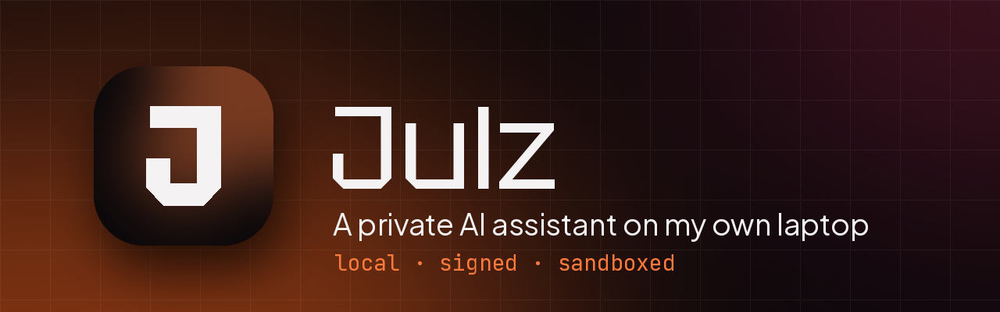
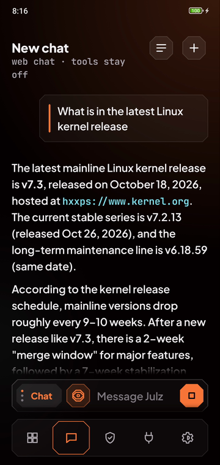
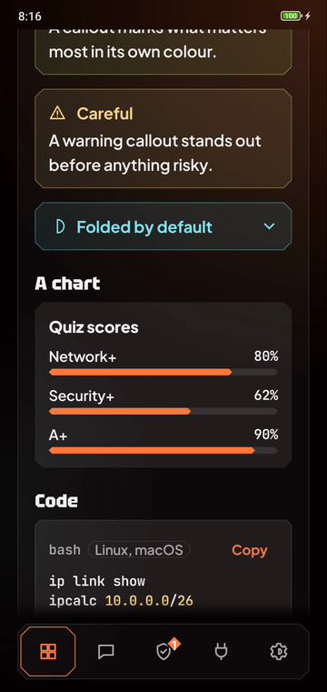
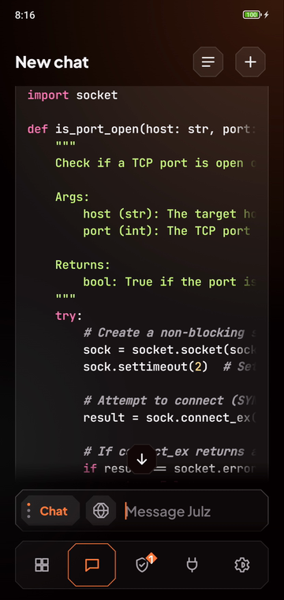
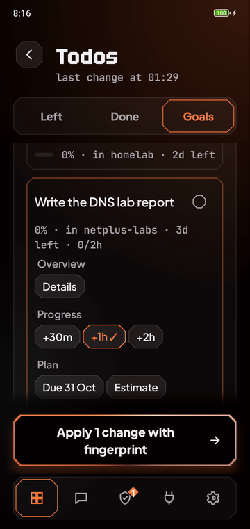
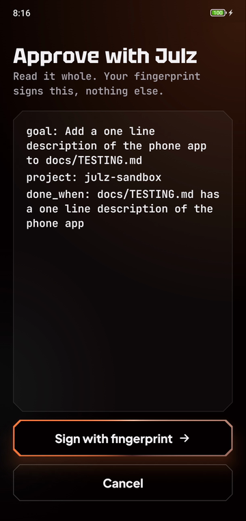
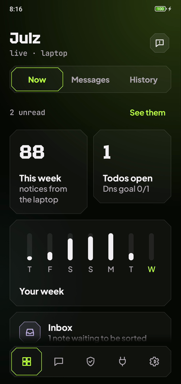

<div align="center">



<br>

**[Watch it](#watch-it)** &nbsp;&nbsp;
**[The app](#the-app)** &nbsp;&nbsp;
**[How it stays safe](#how-it-stays-safe)** &nbsp;&nbsp;
**[What is in here](#what-is-in-here)** &nbsp;&nbsp;
**[Reading order](#reading-order)** &nbsp;&nbsp;
**[Tests](#running-the-tests)**

<br>

[](https://github.com/lounesart/julz/actions/workflows/ci.yml)


</div>

<br>

A private AI assistant that runs on my own laptop. She is a study mentor who knows my notes,
does small jobs through tools I wrote myself, and can hand bigger coding tasks to Claude Code
behind a manual approval step. Everything runs locally on free software, and every limit is
enforced in code or by the operating system rather than by the prompt.

There is also an Android app, so I can talk to her, see my todos and notes, and approve her
work with my fingerprint from the phone. It reaches the laptop over a private network only.

> [!NOTE]
> This is my own setup, built around one laptop and one phone. The code is here to read and learn
> from. It is not a packaged product with an installer.

* * *

## Watch it

<div align="center">

<a href="docs/media/julz-promo.mp4"></a>

<sub>A one minute tour of the phone app. Tap the loop for the full video.</sub>

</div>

<div align="right"><a href="#readme">Back to top</a></div>

## The app

<div align="center">

| | | |
|:---:|:---:|:---:|
|  |  |  |
| Web search through my own SearXNG | Notes drawn with callouts and charts | Code in its own colours |
|  |  |  |
| Goals with hours and due dates | Every change signed with my fingerprint | Several looks, sharp or round |

</div>

Three modes on one wheel. Chat to think out loud, Learn to be taught, Notes to ask only what I
wrote. Answers show tables, callouts, charts and highlighted code, and a long press on any answer
retries it, saves it to my notes or keeps it as a test case when it was wrong.

<div align="right"><a href="#readme">Back to top</a></div>

## How it stays safe

- The models, the chat and my notes stay on the laptop. The phone reaches it over Tailscale only.
- Claude Code runs a task only after I read the exact spec on the phone and sign it with my
  fingerprint, and then inside a sandbox with its own project folder.
- Text from web pages is treated as data. Evals check that pages written to give her orders fail.
- Every change to my notes is a git commit, so anything she did can be undone, and the phone
  tells me when a note was deleted.
- Each systemd unit is locked down on its own, and every push runs the tests and a gitleaks scan.

> [!IMPORTANT]
> The full threat model stays private. To report a security problem, see
> [.github/SECURITY.md](.github/SECURITY.md).

<div align="right"><a href="#readme">Back to top</a></div>

## What is in here

| Part | Files |
|---|---|
| Models built from one personality prompt | `modelfiles/`, `build-models.sh` |
| Hardened launchers for Open WebUI, SearXNG and Speaches | `run-webui.sh`, `run-searxng.sh`, `run-speaches.sh` |
| Tools julz can call inside Open WebUI | `tools/julz_notes.py`, `tools/julz_pocket.py`, `tools/julz_delegate.py` |
| Filters for the reply language, done tasks and honest saves (a warning when she claims a change no tool made) | `functions/` |
| Approval gate and sandboxed runner for Claude Code | `julz_gate.py`, `julz-approve.py`, `julz-run.py`, `julz-clean.py` |
| Approver for the phone, signed with a passkey or the phone's own device key | `julz-approve-web.py`, `julz_webauthn.py`, `julz_devicekey.py`, `approver/` |
| The phone app, in Kotlin with Jetpack Compose | `android/` |
| Gateway between the app's chat and Open WebUI, with web search through my own SearXNG and the sources shown | `julz-chat.py` |
| Push notices to the phone from my own server | `julz-notify.py`, `julz-ntfy.py` |
| Encrypted drop box that julz can lock but not open | `pocket-keygen.py`, `pocket-open.py` |
| Notes vault in git, with the changes I confirmed applied by a unit | `julz_vault.py`, `julz-vault.py` |
| Her memory of my notes, kept in step with the vault | `sync-knowledge.py`, `julz-mem-sync.py`, `julz-keep.py`, `julz-keep-sync.py` |
| Evals for recall, formatting, honest tool replies, and web pages that try to give her orders | `eval-*.py`, `eval/` |
| systemd user units, each locked down on its own | `systemd/` |
| Deploy of a tested, tagged commit for the units, with rollback | `deploy.py` |
| Tests, about 1,650 in Python and 400 in the app | `tests/`, `android/app/src/test/` |

| Model | Base | Use |
|---|---|---|
| julz | qwen3.5:4b | everyday questions, fast, fits on the GPU |
| julz-pro | qwen3.5:9b | harder questions, slower, too big for a 6 GB GPU |
| julz-sec | qwen2.5-coder:7b | code and security review |

Every push runs the tests and a gitleaks scan of the whole history on GitHub Actions.

<div align="right"><a href="#readme">Back to top</a></div>

## Reading order

1. systemd/README.md for the units and how they are set up.
2. docs/TESTING.md for the checks that run before every merge and on the phone.
3. docs/design/README.md for the app's design system.
4. .github/SECURITY.md for how to report a security problem.
5. docs/UNINSTALL.md for removing it all again.

My plans, notes and the full threat model stay private.

## Running the tests

```
python3 -m unittest discover -s tests
```

The sandbox tests need `bwrap` and skip themselves without it, and the unit tests skip without
a systemd user session.

> [!TIP]
> The phone app has its own tests. Run them from `android/` with `./gradlew testDebugUnitTest`.

<div align="right"><a href="#readme">Back to top</a></div>
