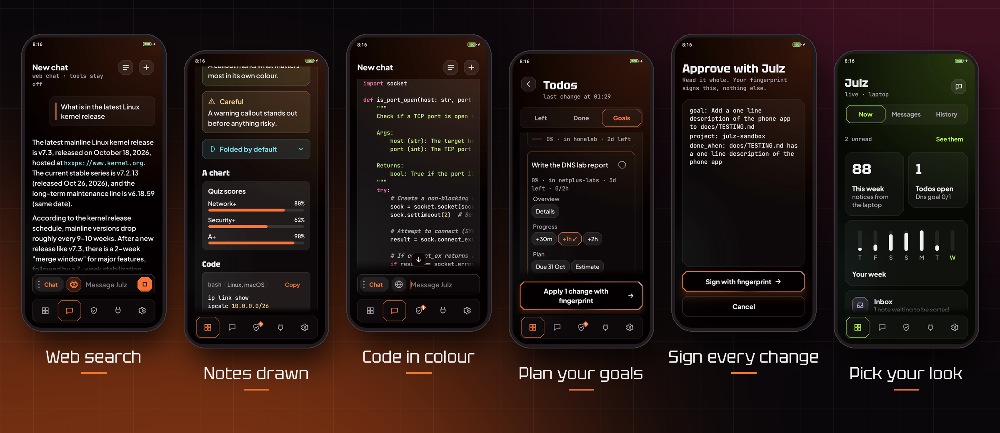

<div align="center">


<br><br>

<a href="#watch-it"></a>
<a href="#the-app"></a>
<a href="#how-it-stays-safe"></a>
<a href="#what-is-inside"></a>
<a href="#reading-order"></a>
<a href="#running-the-tests"></a>

<br><br>

[](https://github.com/lounesart/julz/actions/workflows/ci.yml)


</div>

<br>

A private AI assistant that runs on my own laptop. She is a study mentor who knows my notes,
does small jobs through tools I wrote myself, and can hand bigger coding tasks to Claude Code
behind a manual approval step. Everything runs locally on free software, and every limit is
enforced in code or by the operating system rather than by the prompt.

There is also an Android app, so I can talk to her, see my todos and notes, and approve her
work with my fingerprint from the phone. It reaches the laptop over a private network only.

> [!NOTE]
> This is my own setup, built around one laptop and one phone. The code is here to read and learn
> from. It is not a packaged product with an installer.


## Watch it

<div align="center">

<a href="docs/media/julz-promo.mp4"></a>

<sub>A one minute tour of the phone app. Tap the loop for the full video.</sub>

</div>


## The app



Three modes on one wheel. Chat to think out loud, Learn to be taught, Notes to ask only what I
wrote. Answers show tables, callouts, charts and highlighted code, and a long press on any answer
retries it, saves it to my notes or keeps it as a test case when it was wrong.

<div align="right"><a href="#readme"><sub>Back to top</sub></a></div>


## How it stays safe

- The models, the chat and my notes stay on the laptop. The phone reaches it over Tailscale only.
- Claude Code runs a task only after I read the exact spec on the phone and sign it with my
  fingerprint, and then inside a sandbox with its own project folder.
- Text from web pages is treated as data. Evals check that pages written to give her orders fail.
- Every change to my notes is a git commit, so anything she did can be undone, and the phone
  tells me when a note was deleted.
- Each systemd unit is locked down on its own, and every push runs the tests and a gitleaks scan.

> [!IMPORTANT]
> The full threat model stays private. To report a security problem, see
> [.github/SECURITY.md](.github/SECURITY.md).

<div align="right"><a href="#readme"><sub>Back to top</sub></a></div>


## What is inside

<details>
<summary><b>The laptop side</b> &nbsp; models, launchers, the chat gateway, deploy</summary>
<br>

- Models built from one personality prompt in `modelfiles/` and `build-models.sh`
- Hardened launchers for Open WebUI, SearXNG and Speaches in `run-webui.sh`, `run-searxng.sh` and `run-speaches.sh`
- The gateway between the app's chat and Open WebUI, with web search through my own SearXNG and the sources shown, in `julz-chat.py`
- Push notices to the phone from my own server in `julz-notify.py` and `julz-ntfy.py`
- systemd user units, each locked down on its own, in `systemd/`
- Deploy of a tested, tagged commit for the units, with rollback, in `deploy.py`

</details>

<details>
<summary><b>The phone</b> &nbsp; Kotlin and Jetpack Compose</summary>
<br>

- The app in `android/`, with its design system in `docs/design/`
- The approver, signed with a passkey or the phone's own device key, in `julz-approve-web.py`, `julz_webauthn.py`, `julz_devicekey.py` and `approver/`

</details>

<details>
<summary><b>Safety</b> &nbsp; the gate, the sandbox, honest saves</summary>
<br>

- Approval gate and sandboxed runner for Claude Code in `julz_gate.py`, `julz-approve.py`, `julz-run.py` and `julz-clean.py`
- Filters for the reply language, done tasks and honest saves, a warning when she claims a change no tool made, in `functions/`
- An encrypted drop box that julz can lock but not open, in `pocket-keygen.py` and `pocket-open.py`

</details>

<details>
<summary><b>Notes, memory and evals</b> &nbsp; what she knows and how it is checked</summary>
<br>

- Tools julz can call inside Open WebUI in `tools/julz_notes.py`, `tools/julz_pocket.py` and `tools/julz_delegate.py`
- The notes vault in git, with the changes I confirmed applied by a unit, in `julz_vault.py` and `julz-vault.py`
- Her memory of my notes, kept in step with the vault, in `sync-knowledge.py`, `julz-mem-sync.py`, `julz-keep.py` and `julz-keep-sync.py`
- Evals for recall, formatting, honest tool replies, and web pages that try to give her orders, in `eval-*.py` and `eval/`
- Tests, about 1,650 in Python and 400 in the app, in `tests/` and `android/app/src/test/`

</details>

<br>

<div align="center">


<br>

<br>


</div>

<div align="right"><a href="#readme"><sub>Back to top</sub></a></div>


## Reading order

1. systemd/README.md for the units and how they are set up.
2. docs/TESTING.md for the checks that run before every merge and on the phone.
3. docs/design/README.md for the app's design system.
4. .github/SECURITY.md for how to report a security problem.
5. docs/UNINSTALL.md for removing it all again.

My plans, notes and the full threat model stay private.

## Running the tests

```
python3 -m unittest discover -s tests
```

The sandbox tests need `bwrap` and skip themselves without it, and the unit tests skip without
a systemd user session.

> [!TIP]
> The phone app has its own tests. Run them from `android/` with `./gradlew testDebugUnitTest`.

<div align="right"><a href="#readme"><sub>Back to top</sub></a></div>
